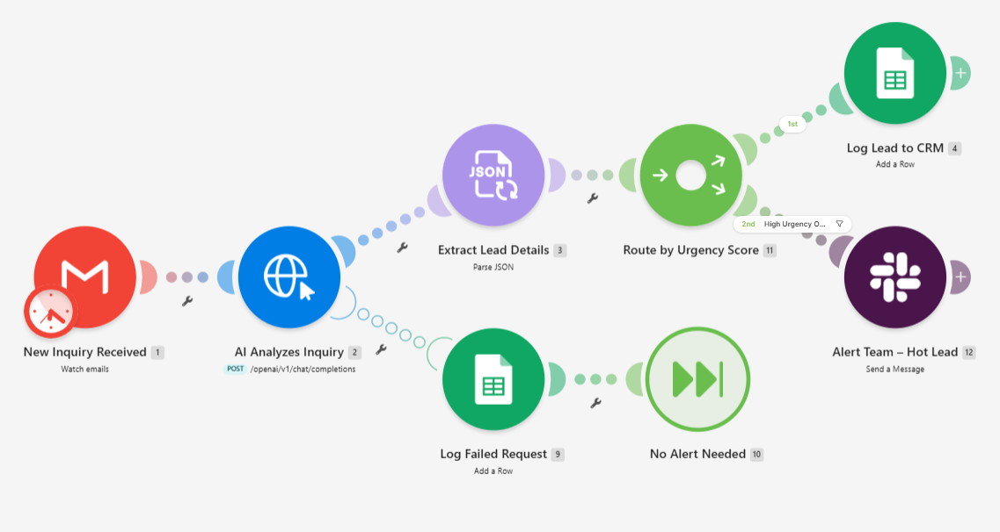
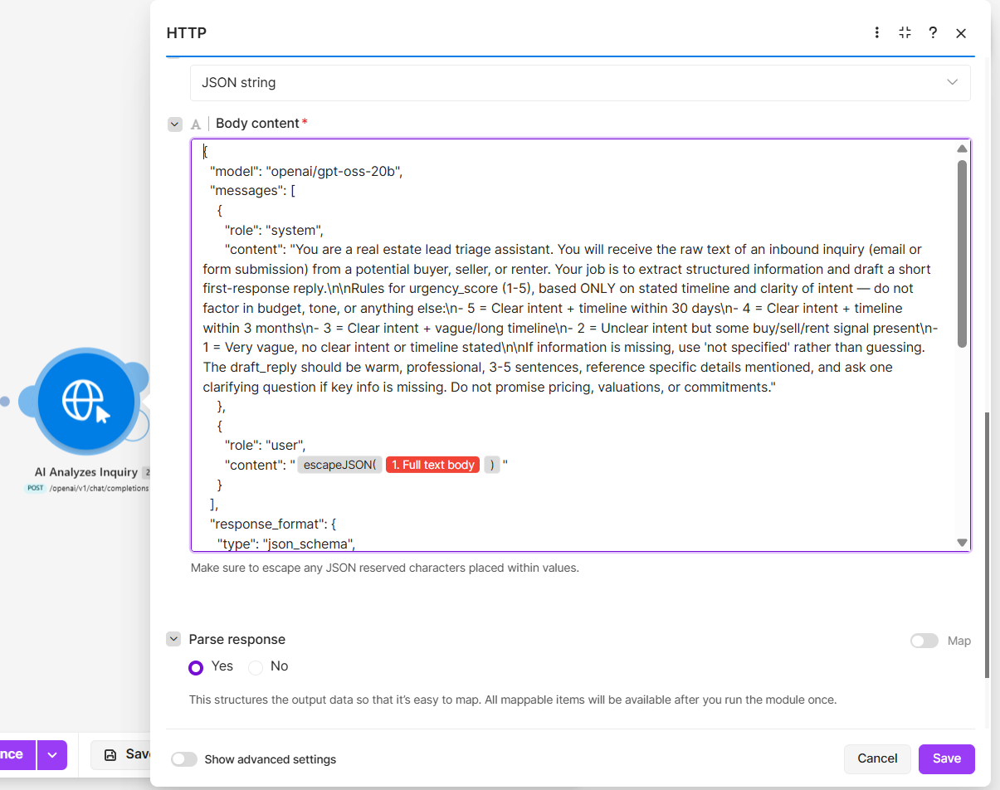
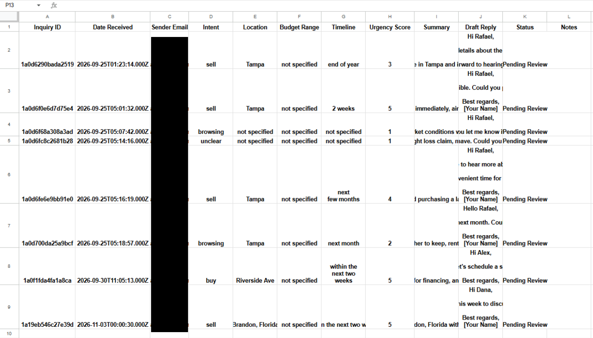
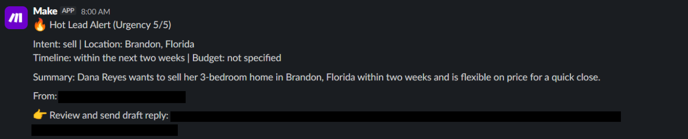
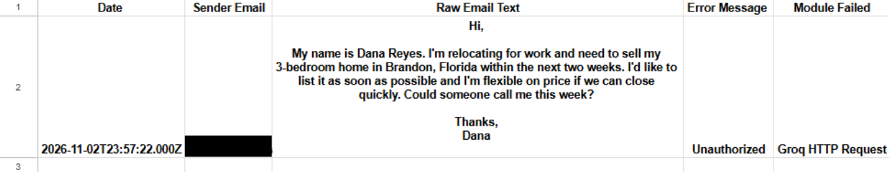

# AI Real Estate Inquiry Triage Agent
Portfolio project (simulated client: GrowthForge Digital). Tested with sample inquiry emails, not real client data.

## Problem
Real estate agents and small brokerages receive buyer, seller, and renter inquiries as free-text emails with no consistent format, mixed signals, and very different levels of urgency. Without triage, every email has to be read and prioritized by a person. Hot leads (people ready to move within weeks) wait in the same queue as casual browsers, and urgency gets judged differently depending on who reads the email.

## Process
The design principle: AI assists, a human decides. The agent prepares and prioritizes. It never sends anything on its own.

1. **Capture:** a Gmail inbox is watched for emails with a dedicated label, so the trigger fires only on inquiries I deliberately flag, not on every message.
2. **Extract and score:** the email text goes to an LLM with a system prompt that defines what to extract (intent, location, budget range, timeline) and an objective urgency rule. Urgency is based only on the stated timeline and the clarity of intent, not on tone or budget, so the score can be checked and explained. The model is told not to invent missing details, so an unmentioned budget is marked "not specified".
3. **Structure the output:** the request enforces a strict JSON schema (name, intent, location, budget_range, timeline, urgency_score, summary, draft_reply), so a malformed response cannot reach the CRM.
4. **Route and act:** every inquiry is logged with its summary and a draft reply, marked "Pending Review". A router also checks the score, and a perfect 5 triggers an immediate Slack alert.
5. **Handle failure:** if the AI request fails, an error route logs the raw email, sender, and error to a "Failed - Manual Review" tab, and the scenario carries on with the next inquiry.

Urgency rule:

| Score | Meaning |
|---|---|
| 5 | Clear intent and a timeline within 30 days |
| 4 | Clear intent and a timeline within 3 months |
| 3 | Clear intent, vague or long timeline |
| 2 | Unclear intent, but some buy, sell, or rent signal |
| 1 | Very vague, no clear intent or timeline |

## Tools
Make, Gmail, Groq API (openai/gpt-oss-20b, called by HTTP with strict JSON-schema output), Google Sheets, Slack.

## Automation
```text
Gmail (Watch Emails, labeled)
  -> HTTP: Groq chat completion (system prompt + JSON schema)
  -> [on success] Parse JSON
  -> Router
       Branch 1 (always): Google Sheets - Add Row (CRM)
       Branch 2 (urgency_score = 5 only): Slack alert
  -> [on failure] Google Sheets - Add Row (Failed - Manual Review), then continue
```

Two design decisions:
- The email body goes through `escapeJSON()` before it is placed in the request. Raw line breaks in real emails broke the JSON payload during testing.
- A model with strict JSON-schema mode was chosen over best-effort JSON, so malformed output cannot break parsing downstream.

## Testing
| Test case | Result |
|---|---|
| Clear urgent lead (sell, 2 weeks) | Scored 5/5, logged to the CRM, Slack alert sent |
| Vague inquiry ("what's going on with the market") | Intent "browsing", missing fields "not specified", scored 1/5 |
| Spam or unrelated content | Intent "unclear" and the summary identified it as spam, but a generic reply draft was still written (see limitations) |
| Mixed intent (selling a home to buy a bigger one) | Primary intent "sell", timeline "next few months", scored 4/5 |
| Deadline stated but intent undecided (keep, rent, or sell) | Intent stayed "browsing", scored 2/5, matching the rule that urgency needs clear intent, not only a timeline |

## Result
- Unstructured inquiries become schema-checked data: intent, location, budget, timeline, an explainable urgency score, and a reply draft ready for review.
- Urgency-5 leads reach Slack in real time instead of waiting in a spreadsheet.
- A person approves every outbound message. Nothing is sent automatically.
- One bad AI response does not stop the pipeline. It is logged and the next inquiry is processed.

## Known limitations
- For spam or unrelated emails the agent still writes a generic reply draft, because the draft step does not check the classification first. Planned fix: if intent is "unclear" and the summary says the email is not about real estate, skip the draft and route the row to "Failed - Manual Review" or a "Not a Lead" status.
- Tested on a small set of sample emails. Results on real inbox traffic are untested.
- Scoring depends only on timeline and intent clarity by design, so it ignores budget and other signals.

## Screenshots






Full case study (PDF): https://drive.google.com/file/d/18Z6O6Ha1iFBUKeSZdfAY2IMkqyOpZSrU/view?usp=sharing
