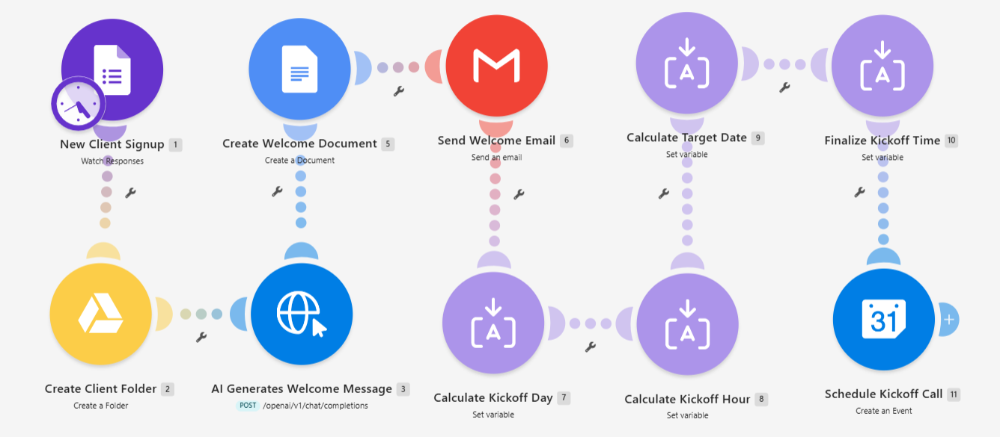
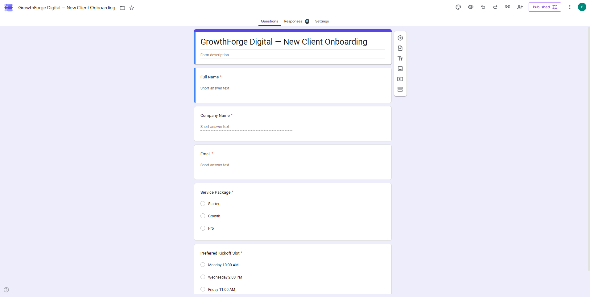
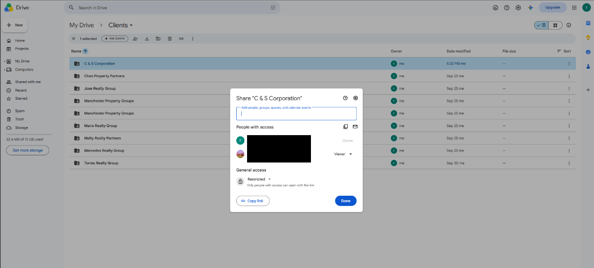
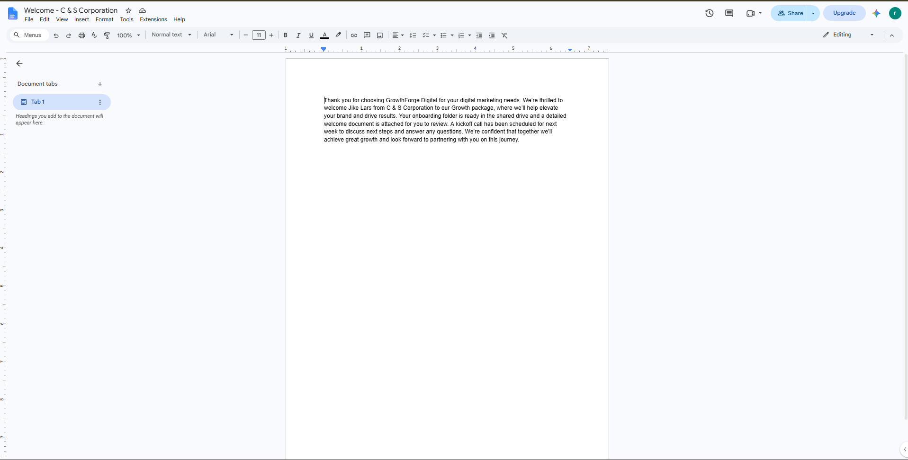
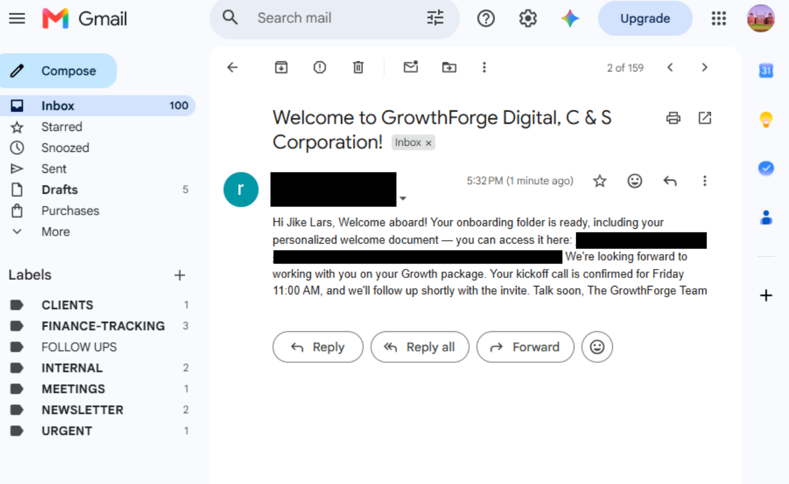
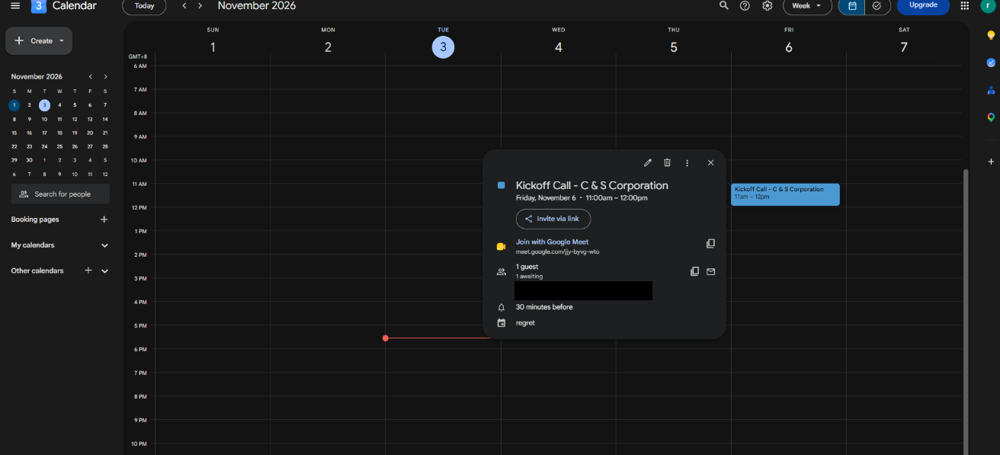

# Client Onboarding Automation
Portfolio project (simulated client: GrowthForge Digital). Tested with test submissions, not real clients.

## Problem
Onboarding a new client by hand means creating a folder, sharing it, writing a welcome message, sending an email, and finding a time for a kickoff call. Each step is small, but together they are slow, inconsistent from client to client, and easy to get wrong when the team is busy.

The brief: when a new client fills in one onboarding form, set up everything they need to start, with no manual work.

## Process
- **One form as the front door.** The form collects full name, company name, email (with format validation), service package (Starter, Growth or Pro) and preferred kickoff slot (Mon 10am, Wed 2pm or Fri 11am). Responses are linked to a Google Sheet, so every client is logged. Dropdowns for package and slot mean the automation never has to interpret free text.
- **Private folders.** A Drive folder named after the company is created inside a Clients folder and shared as Reader to the client's own email only, not to anyone with the link.
- **AI welcome, protected against special characters.** An HTTP call to Groq (openai/gpt-oss-20b) writes a plain-text welcome using the client's name, company and package. Client text can contain quotes and line breaks that break the request body, so the whole user message is wrapped in a single `escapeJSON()` call, which leaves one place to get wrong instead of one per variable.
- **Each output in its place.** The welcome is saved as a Google Doc named "Welcome - [Company]" inside the client's folder. The email stays short and links to the folder instead of repeating the welcome text.
- **Kickoff scheduling with no hardcoded dates.** Four chained Set Variable steps turn the chosen slot into a real date and time: map the day to Make's day numbering (Sunday is 1, Saturday is 7), map the slot to an hour (10, 14 or 11), build the date with `setDay(now; targetDayNumber)`, then set the hour and zero the minutes. If that day has already passed this week, seven days are added, so the kickoff always lands on the next occurrence. Google Calendar creates a one-hour event with a Google Meet link and the client as an attendee.
- **A deliberate design choice.** A router with hardcoded dates was simpler to explain, but it would need updating by hand every week. A date formula costs more to build once and then needs no maintenance.

## Tools
Make (Google Forms, Google Drive, HTTP, Google Docs, Gmail, Tools Set Variable and Google Calendar modules), Google Forms, Google Sheets, Groq API (openai/gpt-oss-20b).

## Automation
```text
Google Forms (new response)
  -> Google Drive: create folder in Clients, share as Reader to the client's email
  -> HTTP: Groq writes the welcome message (escapeJSON around the user message)
  -> Google Docs: create "Welcome - [Company]" in the client folder
  -> Gmail: short email linking to the folder
  -> Set Variable x4: day number, hour, target date, final date and time
  -> Google Calendar: 1-hour event with a Meet link and the client invited
```

## Testing and bugs found
Two real bugs came up during testing:
1. **A stale variable reference.** After renaming a variable (targetDayName to targetDayNumber), a reference to the old name did not raise an error. It silently resolved to the wrong value, which is worse than a crash.
2. **A timezone mismatch.** The Make account timezone was America/New_York instead of Asia/Manila, which shifted the event times.

Both were fixed, and I re-ran the test until the Calendar event showed the correct day and time.

## Result
- One form submission sets up a private Drive folder, a personalized welcome document, a short email linking to it, and a kickoff event with a Meet link and the client invited.
- The folder is shared only with the client's own email address.
- The kickoff date and time come from the client's chosen slot, with no hardcoded dates, and roll forward to the next week when needed.
- The welcome request is protected against special characters in client text.

## Known limitations
- Kickoff slots are limited to three fixed options.
- The scenario does not check the calendar for conflicts before creating the event.
- Tested with test submissions only, for a fictional client.

## Screenshots







Full case study (PDF): https://drive.google.com/file/d/1eE9FdIiFJd5bOjWuJ66pdVot4Ho07ifl/view?usp=sharing
