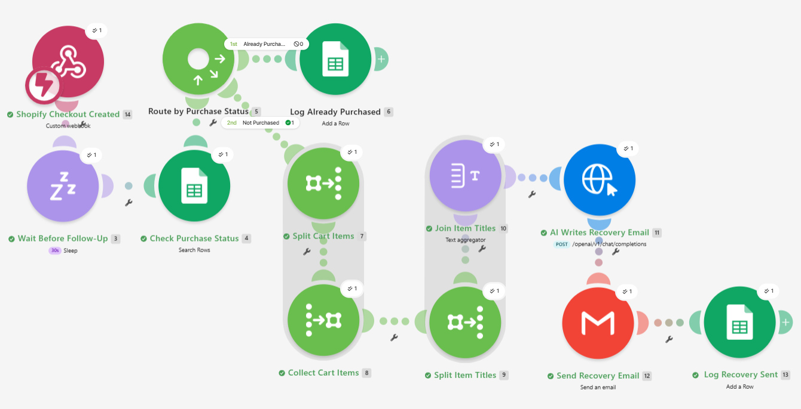
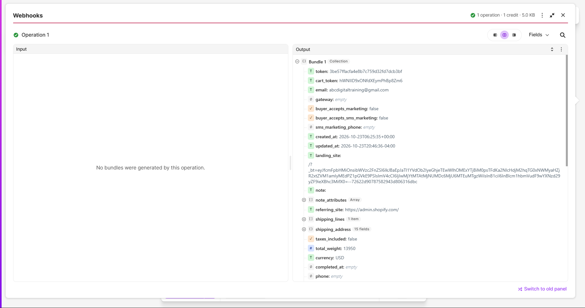
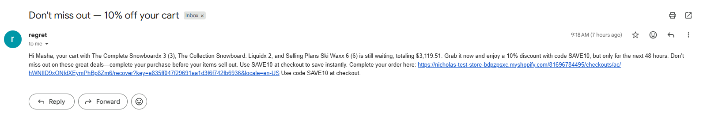
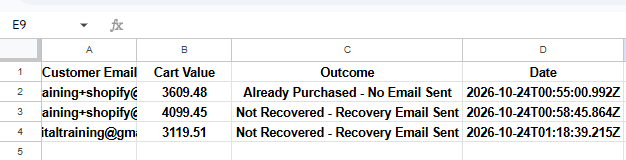
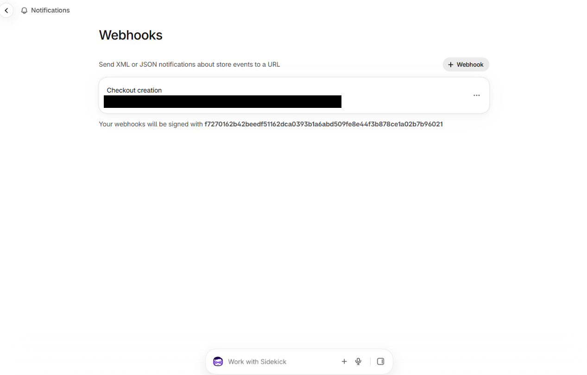

# Shopify Abandoned Cart Recovery
Portfolio project (simulated client). Built on a free Shopify development store with test checkouts only. No real customers or orders.

## Problem
Shoppers add items and start checkout, then leave. Without a follow-up, that sale is lost, and sending the same message to people who already bought is worse.

## Process
I first built this flow in Make with a Google Form standing in for a store. I then rebuilt it on a real Shopify checkout event: created a dev store, registered a webhook for the checkout creation event, and examined the live payload (email, checkout recovery URL, items, total) before mapping any field.

## Tools
Make, Shopify (development store), Groq API (openai/gpt-oss-20b), Gmail, Google Sheets.

## Automation
1. A Shopify checkout starts and Shopify sends the event to a Make custom webhook.
2. Sleep (30 seconds in the demo; a real setup would wait 24 to 48 hours).
3. Search a Purchase Confirmation sheet for the customer's email.
4. Router:
   - **Already purchased:** log `Already Purchased - No Email Sent`. No email goes out.
   - **Not purchased:** an Iterator and aggregators build a list of every cart item, the Groq model writes a short recovery email that names the items and includes the discount code SAVE10, Gmail sends it with the checkout recovery link, and the result is logged as `Recovery Email Sent`.

## Result
A real Shopify checkout triggers the whole flow end to end. In testing, one email named all three items in the cart, showed the correct total, and linked back to the checkout. Both routes were tested: the purchased route sent nothing and logged only.

## Known limitations
- The purchase check reads a Google Sheet that stands in for order data. It is not connected to real Shopify orders.
- The 30-second wait is a demo value for a 24 to 48 hour delay.
- Single recovery email. The earlier two-email sequence was simplified for this version.
- Development store and test checkouts only. Not tested with real traffic.
- The webhook's signature is not verified, so anyone with the URL could send data to it.
- No handling yet for a checkout without an email address.
- The customer's name depends on Make reading Shopify's address data correctly. It worked in testing, and it needs re-checking if the payload structure changes.
- The scenario is switched off after testing so it does not run on every checkout.

## Screenshots

