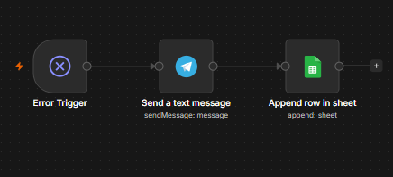
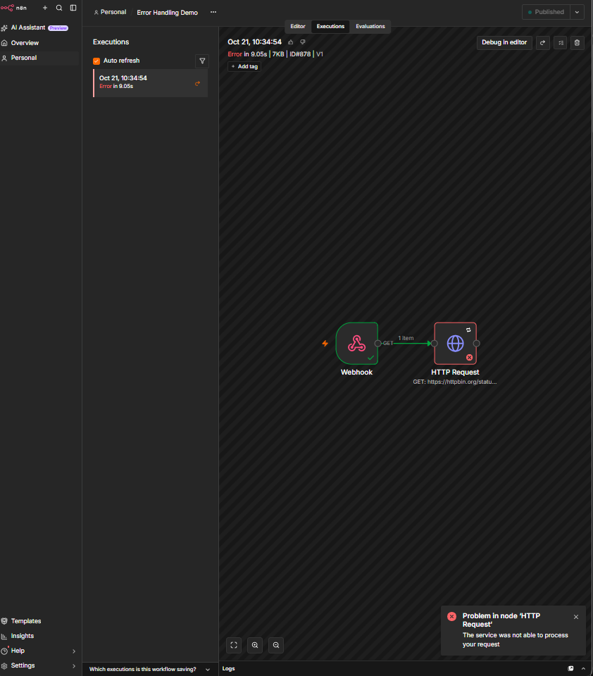
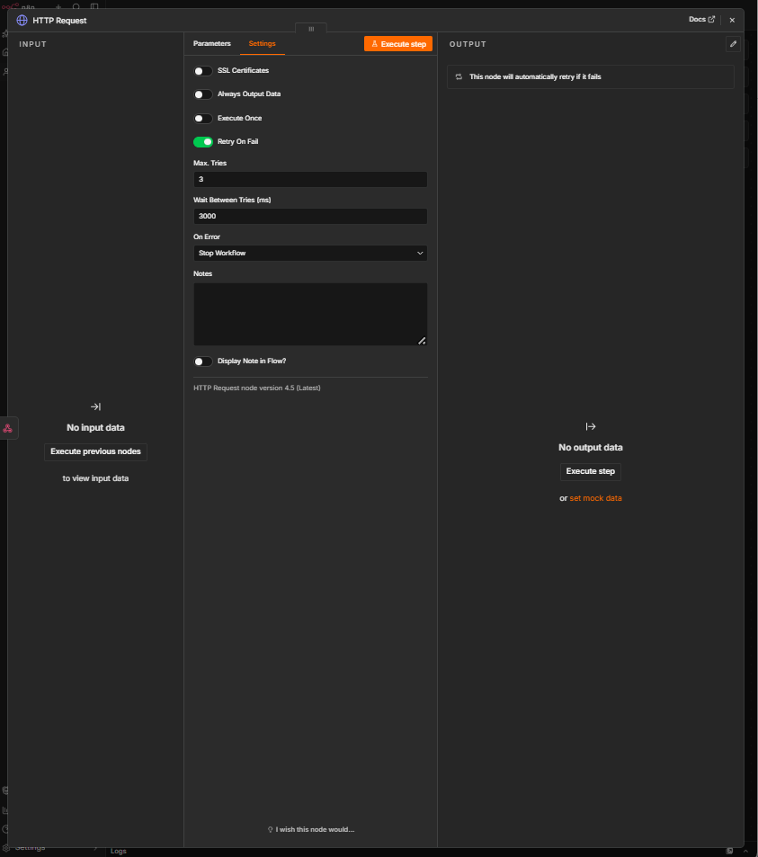
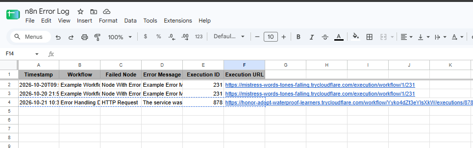
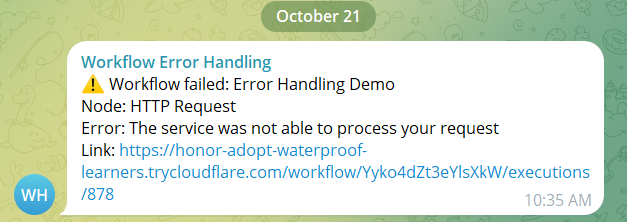

# Global Error Handler
Portfolio project. Tested with a deliberate failure.

## Problem
Automations fail silently, so nobody knows a lead or task was missed.

## Process
Built one central error workflow and attached it to each production workflow. Added retries to absorb temporary API errors.

## Tools
n8n Error Trigger, Telegram, Google Sheets (service account).

## Automation
Error Trigger, Telegram alert (workflow, node, message, link), append a row to an error log sheet. API nodes use Retry On Fail: 3 tries, 3000 ms apart.

## Result
A deliberately failing HTTP node retried (execution took about 9 seconds), then alerted Telegram and logged the error.

## Known limitations
Does not fire on manual test runs. It cannot report that n8n itself is down; a Docker restart policy covers that.

## Screenshots
# Invoice Extractor
Portfolio project (simulated client). Tested on 10 fake invoices only. No real supplier documents were used.

## Problem
Shops that buy stock from many suppliers re-type invoice details into spreadsheets by hand. It is slow, and typing errors and wrong supplier totals go unnoticed.

## Process
I wrote 10 fake supplier invoices (6 PDFs, 3 JPGs made to look like phone photos, and 1 PDF with a deliberately wrong printed total) and a hand-made answer key. I built the workflow step by step, checking each stage against the key: first reading one invoice, then asking for structured JSON, then adding a validation step, then logging to a sheet.

## Tools
n8n (self-hosted), Google Gemini API ([confirm model: gemini-3.5-flash-lite]), Google Sheets, Telegram.

## Automation
1. A form accepts an invoice upload (PDF or photo).
2. Gemini reads the file and returns JSON: supplier, invoice number, date, currency, subtotal, discount, VAT, total, and every line item (code, product, quantity, unit cost, line total).
3. A Code node parses the JSON and checks it: each line's quantity times unit cost, the sum of the lines, and whether the printed total matches the lines, discount and VAT. It sets `needs_review` with a reason when something fails.
4. Every invoice is logged to an `Invoices` tab, and its lines go to a `Line Items` tab.
5. Flagged invoices also send a Telegram alert with the file name, supplier, and reason.

The model is told to copy printed figures and not correct them, so a supplier's wrong total is caught by the validation step and not silently fixed.

## Result
Scored against the answer key, field by field:
- Invoice-level fields (supplier, number, date, currency, subtotal, discount, VAT, total): 72 of 72 correct on the 9 invoices logged in the first run.
- Line-item fields (code, product, quantity, unit cost, line total): 275 of 275 correct across all 10 invoices (55 lines).
- Tricky cases handled: a date written as 12/10/2026 read in UK format, a 5% trade discount applied before VAT, an invoice in EUR, and a dark, tilted, noisy photo.
- The invoice with a wrong printed total (370.20 against lines adding up to 358.20) was flagged for review and sent a Telegram alert.

## Known limitations
- Small synthetic test set. The PDFs are clean and generated, and the "photos" are the same pages with simulated tilt, blur and noise, not real camera photos. Results on real invoices will vary.
- One model was tested.
- Upload by form only. It does not read supplier emails yet.
- It does not compare products against a till or EPOS system, and it does not detect duplicate invoices.
- Google's free tier has daily request limits, and free-tier requests may be used to improve Google's products, so only fake or non-sensitive documents should be used with it.
- Flagged invoices still need a person to review them.

## Screenshots

