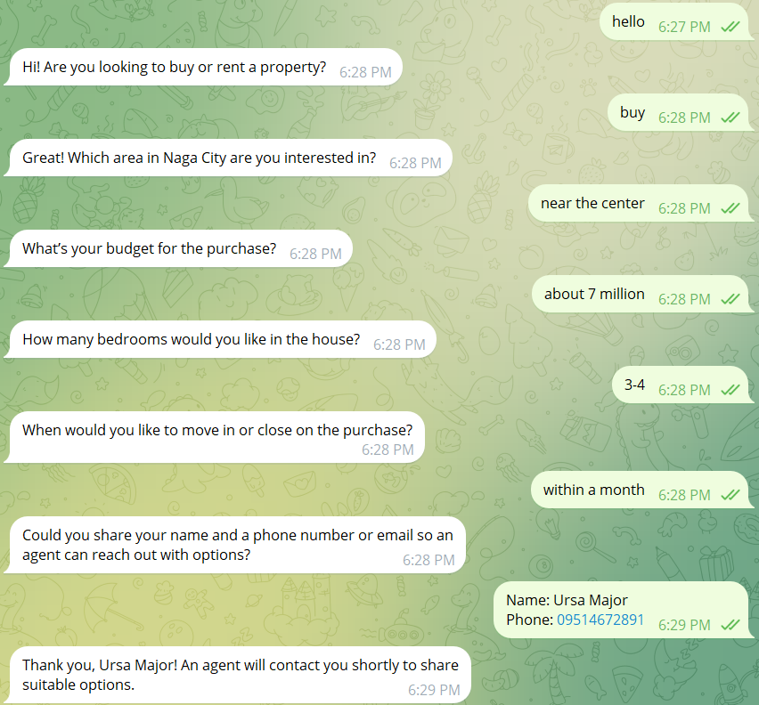
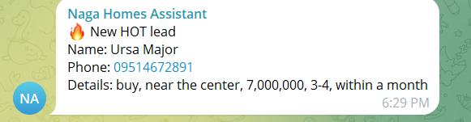

# Naga Homes Assistant
Portfolio project (simulated client).

## Problem
Property inquiries arrive at all hours and agents lose hot leads in slow replies.

## Process
Built a chat-only agent that answers questions, then asks for contact details before saving anything.

## Tools
n8n (self-hosted, Docker), Groq (gpt-oss-120b), Airtable, Telegram, Cloudflare quick tunnel.

## Automation
Telegram chat, Simple Memory keyed by chat ID, Information Extractor once phone or email is given, Airtable lead record, memory reset. Label: Hot (moving within about a month with a clear budget), Warm, or Cold. Hot leads alert an agent group on Telegram.

## Result
Inquiries are answered instantly and qualified leads land in Airtable with a priority label.

## Known limitations
Runs only while my machine and tunnel are up. Labels are a simple rule, not a validated score.

## Screenshots

