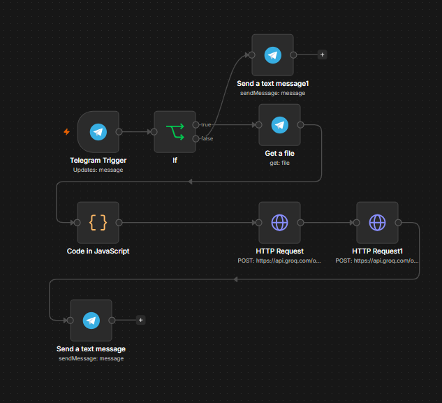
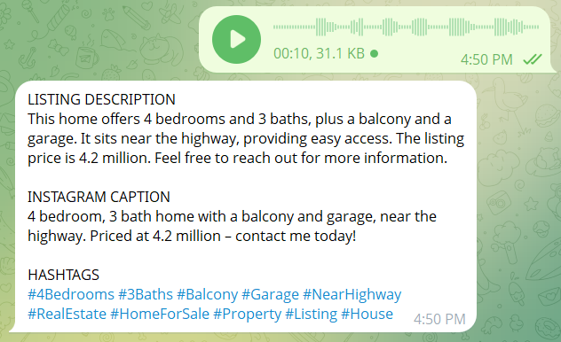

# Voice-Note Listing Bot
Portfolio project (simulated client).

## Problem
Agents describe listings out loud but need written descriptions and social captions.

## Process
Chose voice because agents are often on the move. Kept the output to three deliverables.

## Tools
n8n, Telegram, Groq (whisper-large-v3 and gpt-oss-120b).

## Automation
Voice note, transcription, listing description, Instagram caption, hashtags, reply in Telegram.

## Result
One voice note returns publish-ready copy in the same chat.

## Known limitations
Accuracy depends on audio quality. Copy is not fact-checked against the property record.

## Screenshots

