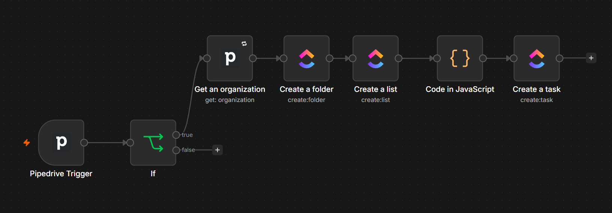
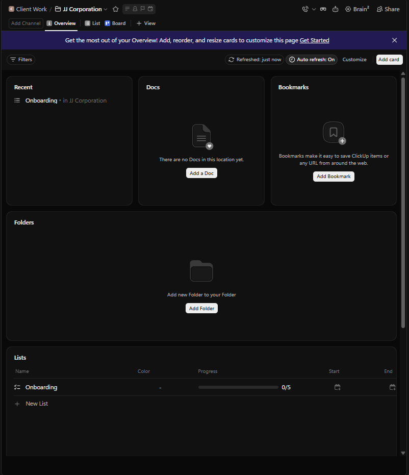
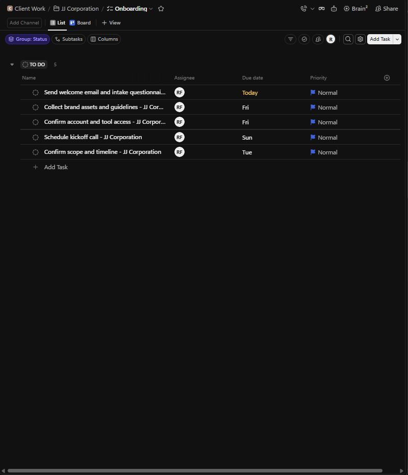

# Won Deal to ClickUp Onboarding
Portfolio project (simulated client). Ran live on a real won deal in my own Pipedrive trial.

## Problem
After a deal closes, onboarding setup is manual and easy to forget.

## Process
Triggered on deal updates, with a check that `won_time` is newly set so re-saved deals do not run twice.

## Tools
n8n, Pipedrive Trigger, ClickUp.

## Automation
Pipedrive Trigger, IF won_time newly set, Get Organization, create ClickUp folder and Onboarding list per client, Code node generates 5 tasks (assignee, relative due dates, priority). Retry on fail on API nodes; errors go to the Global Error Handler.

## Result
A won deal produces a ready-to-use onboarding workspace with no manual setup.

## Known limitations
Folder names come from the organization name; duplicates are not checked. See the [SOP](SOP.md).

## Screenshots

