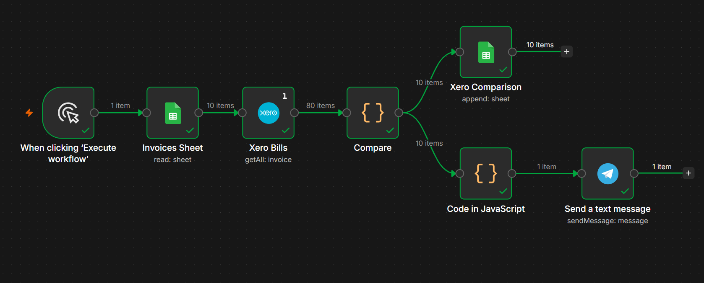
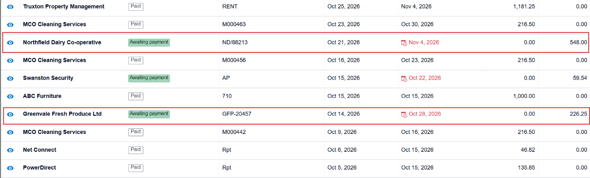
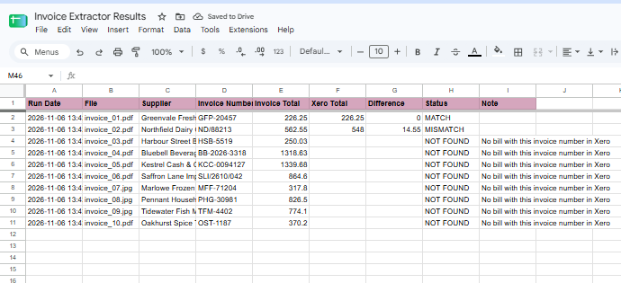
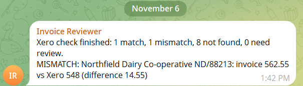

# Xero Invoice Check
Portfolio project. Runs against Xero's demo company with fake data only. Not real accounting work.

## Problem
When supplier invoices are entered into accounting software by hand, mistakes slip in: wrong totals, missing bills, duplicates. Someone has to compare the paperwork against the books, line by line.

## Process
This extends my Invoice Extractor. That workflow reads supplier invoices (PDF or photo) and logs the details to a sheet. This one reads those results, looks up the matching bill in Xero by invoice number, compares the totals, and reports the outcome. I seeded two bills in the Xero demo company by hand, one matching its invoice and one deliberately different, so the check had known answers to find.

## Tools
n8n (self-hosted), Xero API (OAuth2, demo company), Google Sheets, Telegram.

## Automation
```text
Manual trigger
  -> Google Sheets: read extracted invoices
  -> Xero: get all invoices (run once)
  -> Code: keep supplier bills (type ACCPAY), match each extracted invoice by invoice number,
           compare totals, set MATCH, MISMATCH, NOT FOUND or REVIEW
  -> Google Sheets: save every result to a "Xero Comparison" tab
  -> Code + Telegram: one summary message listing any mismatches
```

Checks and design choices:
- Matching uses the invoice number, trimmed and case-insensitive. More than one bill with the same number is flagged for review instead of guessed at.
- Only the numbers are compared. The extracted invoices are in GBP and the demo company is in USD, so currency is not converted.
- No AI step touches Xero data. The comparison is plain code, which keeps the project clear of Xero's developer rules on AI use.
- One summary message replaces one alert per row, so a large batch does not flood the chat.

## Result
On the 10 fake invoices from the Invoice Extractor test set:
- 1 MATCH: the Greenvale invoice agreed with its Xero bill (226.25).
- 1 MISMATCH: the Northfield invoice said 562.55 and its Xero bill said 548.00, a difference of 14.55, and the summary named it.
- 8 NOT FOUND: no bill had been entered for them in Xero.

These outcomes were set up on purpose with seeded bills, so they show that the pipeline works, not that it caught real errors.

## Known limitations
- Demo company only, with seeded test bills. Nothing real was reconciled.
- Matching is by invoice number only. It does not match on supplier name and date when a number is missing or mistyped.
- No currency conversion (GBP invoices, USD demo company).
- Run on demand. No schedule, and each run appends new rows to the results tab.
- It fetches every invoice on each run, which would be slow on a real organisation with many records.
- It depends on a valid Xero sign-in and, in my setup, a self-hosted n8n behind a temporary tunnel address.
- The Xero demo company resets after 28 days, which erases the seeded bills.

## Screenshots




